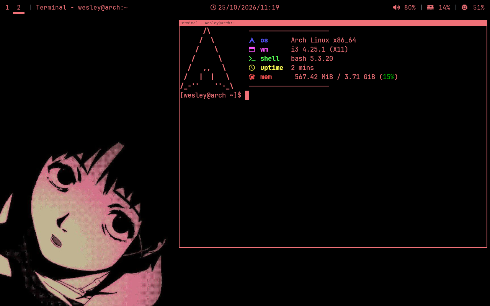

# i3 Rice

A customized Linux desktop setup focused on minimalism, aesthetics, and productivity.


# Preview




# Components

| Component | Description |
|:---|:---|
| `i3` | Tiling window manager |
| `Xfce4-terminal` | Terminal |
| `Polybar` | Status bar |
| `Rofi` | Application launcher |
| `Neovim` | Text editor |
| `Fastfetch` | System information |
| `Thunar` | File manager |
| `feh` | Image viewer and wallpaper manager |
| `btop` | System resource monitor |
| `Squared Material Red` | Rofi theme |


# Repository Structure

```text
.
├── configs/
│   ├── fastfetch/
│   │   └── config.jsonc
│   ├── i3/
│   │   └── config
│   ├── nvim/
│   │   └── init.lua
│   ├── polybar/
│   │   └── config.ini
│   └── rofi/
│       └── config.rasi
├── tema-rofi/
│   └── squared-material-red.rasi
├── wallpapers/
│   └── ...
├── assents/
│   └── preview.png
└── README.md
```

# Keybindings

| Shortcut | Action |
|:---|:---|
| `Super + Enter` | Open terminal |
| `Super + D` | Open application launcher |
| `Super + Shift + Q` | Close focused window |
| `Super + N` | Open Thunar |
| `Super + F` | Toggle fullscreen |
| `Super + B` | Open btop |
| `Super + Shift + Space` | Toggle floating mode |


# Applications

- [i3 Window Manager](https://i3wm.org/)
- [Polybar](https://github.com/polybar/polybar)
- [Rofi](https://github.com/davatorium/rofi)
- [Neovim](https://neovim.io/)
- [Fastfetch](https://github.com/fastfetch-cli/fastfetch)
- [Thunar](https://docs.xfce.org/xfce/thunar/start)
- [feh](https://feh.finalrewind.org/)
- [btop](https://github.com/aristocratos/btop)


Made by Wesley Firmino
